

  <picture>
    <source media="(prefers-color-scheme: dark)" srcset="./assets/hero-dark.png" />
    <source media="(prefers-color-scheme: light)" srcset="./assets/hero-light.png" />
    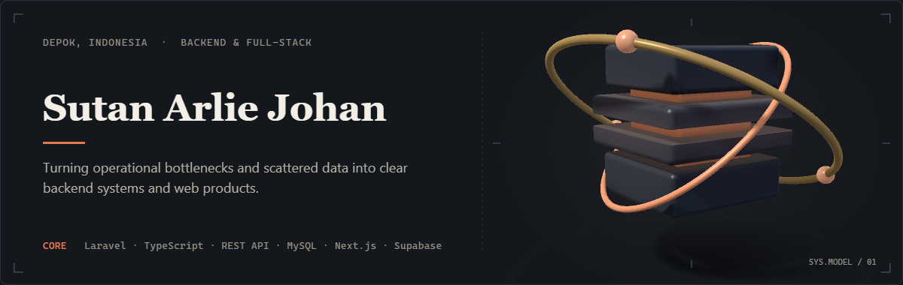
  </picture>

<a href="https://sutan.dev"><picture><source media="(prefers-color-scheme: dark)" srcset="./assets/btn-portfolio-dark.svg" /><source media="(prefers-color-scheme: light)" srcset="./assets/btn-portfolio-light.svg" /></picture></a>&nbsp;<a href="https://github.com/Sutannn13?tab=repositories"><picture><source media="(prefers-color-scheme: dark)" srcset="./assets/btn-repos-dark.svg" /><source media="(prefers-color-scheme: light)" srcset="./assets/btn-repos-light.svg" /></picture></a>&nbsp;<a href="https://www.linkedin.com/in/sutan-arlie-johan-38877635b"><picture><source media="(prefers-color-scheme: dark)" srcset="./assets/btn-linkedin-dark.svg" /><source media="(prefers-color-scheme: light)" srcset="./assets/btn-linkedin-light.svg" /></picture></a>&nbsp;<a href="mailto:sutanarliejohan@gmail.com"><picture><source media="(prefers-color-scheme: dark)" srcset="./assets/btn-email-dark.svg" /><source media="(prefers-color-scheme: light)" srcset="./assets/btn-email-light.svg" /></picture></a>

  <picture>
    <source media="(prefers-color-scheme: dark)" srcset="./assets/architecture-dark.svg" />
    <source media="(prefers-color-scheme: light)" srcset="./assets/architecture-light.svg" />
    
  </picture>

 

  <picture>
    <source media="(prefers-color-scheme: dark)" srcset="./assets/section-work-dark.svg" />
    <source media="(prefers-color-scheme: light)" srcset="./assets/section-work-light.svg" />
    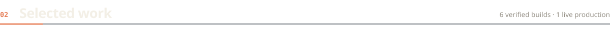
  </picture>

  <a href="https://maukitchen.my.id">
    <picture>
      <source media="(prefers-color-scheme: dark)" srcset="./assets/project-maus-kitchen-dark.png" />
      <source media="(prefers-color-scheme: light)" srcset="./assets/project-maus-kitchen-light.png" />
      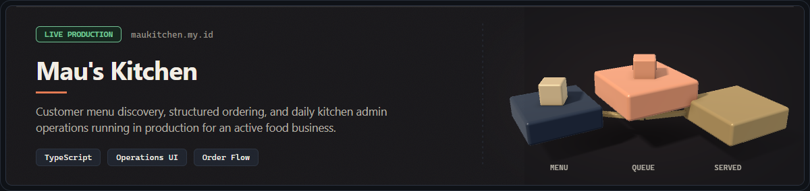
    </picture>
  </a>

<a href="https://maukitchen.my.id"><picture><source media="(prefers-color-scheme: dark)" srcset="./assets/btn-maus-live-dark.svg" /><source media="(prefers-color-scheme: light)" srcset="./assets/btn-maus-live-light.svg" /></picture></a>&nbsp;<a href="https://github.com/Sutannn13/mau-s-kitchen"><picture><source media="(prefers-color-scheme: dark)" srcset="./assets/btn-maus-source-dark.svg" /><source media="(prefers-color-scheme: light)" srcset="./assets/btn-maus-source-light.svg" />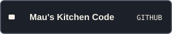</picture></a>

<a href="https://github.com/Sutannn13/Skill-Path-AI"><picture><source media="(prefers-color-scheme: dark)" srcset="./assets/project-skill-path-dark.svg" /><source media="(prefers-color-scheme: light)" srcset="./assets/project-skill-path-light.svg" /></picture></a>&nbsp;<a href="https://github.com/Sutannn13/ar-tata-surya"><picture><source media="(prefers-color-scheme: dark)" srcset="./assets/project-solar-ar-dark.svg" /><source media="(prefers-color-scheme: light)" srcset="./assets/project-solar-ar-light.svg" /></picture></a>

<a href="https://github.com/Sutannn13/press-release-auto-generate"><picture><source media="(prefers-color-scheme: dark)" srcset="./assets/project-press-release-dark.svg" /><source media="(prefers-color-scheme: light)" srcset="./assets/project-press-release-light.svg" />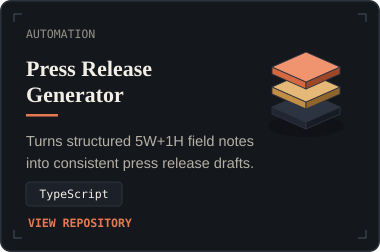</picture></a>&nbsp;<a href="https://github.com/Sutannn13/E-commerce-platform-for-fresh-fish-transactions"><picture><source media="(prefers-color-scheme: dark)" srcset="./assets/project-fresh-fish-dark.svg" /><source media="(prefers-color-scheme: light)" srcset="./assets/project-fresh-fish-light.svg" /></picture></a>&nbsp;<a href="https://github.com/Sutannn13/HMTI-MARGONDA"><picture><source media="(prefers-color-scheme: dark)" srcset="./assets/project-hmti-dark.svg" /><source media="(prefers-color-scheme: light)" srcset="./assets/project-hmti-light.svg" /></picture></a>

 

  <picture>
    <source media="(prefers-color-scheme: dark)" srcset="./assets/section-activity-dark.svg" />
    <source media="(prefers-color-scheme: light)" srcset="./assets/section-activity-light.svg" />
    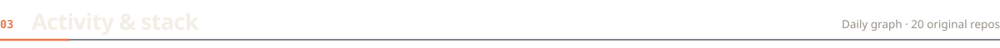
  </picture>

  <picture>
    <source media="(prefers-color-scheme: dark)" srcset="./assets/snake-dark.svg" />
    <source media="(prefers-color-scheme: light)" srcset="./assets/snake-light.svg" />
    
  </picture>

 

  <picture>
    <source media="(prefers-color-scheme: dark)" srcset="./assets/stack-monument-dark.svg" />
    <source media="(prefers-color-scheme: light)" srcset="./assets/stack-monument-light.svg" />
    
  </picture>

 

  <picture>
    <source media="(prefers-color-scheme: dark)" srcset="./assets/section-record-dark.svg" />
    <source media="(prefers-color-scheme: light)" srcset="./assets/section-record-light.svg" />
    
  </picture>

  <picture>
    <source media="(prefers-color-scheme: dark)" srcset="./assets/track-record-dark.svg" />
    <source media="(prefers-color-scheme: light)" srcset="./assets/track-record-light.svg" />
    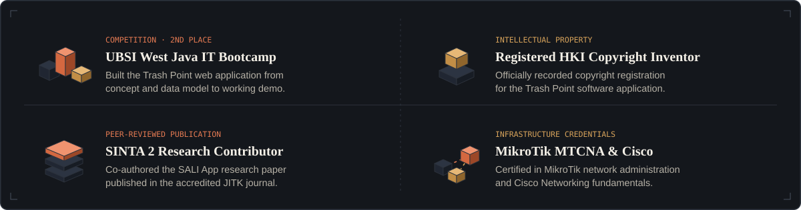
  </picture>

 

  <picture>
    <source media="(prefers-color-scheme: dark)" srcset="./assets/footer-dark.svg" />
    <source media="(prefers-color-scheme: light)" srcset="./assets/footer-light.svg" />
    
  </picture>

<a href="mailto:sutanarliejohan@gmail.com"><picture><source media="(prefers-color-scheme: dark)" srcset="./assets/btn-contact-email-dark.svg" /><source media="(prefers-color-scheme: light)" srcset="./assets/btn-contact-email-light.svg" /></picture></a>&nbsp;<a href="https://www.linkedin.com/in/sutan-arlie-johan-38877635b"><picture><source media="(prefers-color-scheme: dark)" srcset="./assets/btn-contact-linkedin-dark.svg" /><source media="(prefers-color-scheme: light)" srcset="./assets/btn-contact-linkedin-light.svg" /></picture></a>

