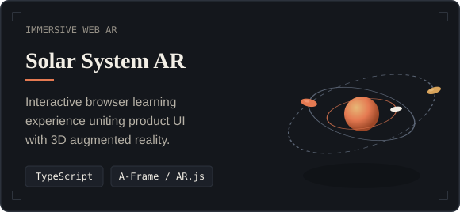

  <picture>
    <source media="(prefers-color-scheme: dark)" srcset="./assets/hero-dark.png" />
    <source media="(prefers-color-scheme: light)" srcset="./assets/hero-light.png" />
    
  </picture>

<a href="https://sutan.dev"><strong>Visit sutan.dev</strong></a> &nbsp;&middot;&nbsp; <a href="https://github.com/Sutannn13?tab=repositories"><strong>Browse repositories</strong></a> &nbsp;&middot;&nbsp; <a href="https://www.linkedin.com/in/sutan-arlie-johan-38877635b"><strong>Connect on LinkedIn</strong></a> &nbsp;&middot;&nbsp; <a href="mailto:sutanarliejohan@gmail.com"><strong>Email me</strong></a>

### How I build

I am Sutan Arlie Johan, an Information Technology student and backend-focused full-stack developer based in Depok, Indonesia. I turn manual processes and scattered operational data into dependable backend systems, APIs, and web interfaces from database schema to deployment.

  <picture>
    <source media="(prefers-color-scheme: dark)" srcset="./assets/architecture-dark.svg" />
    <source media="(prefers-color-scheme: light)" srcset="./assets/architecture-light.svg" />
    
  </picture>

 

### Selected work

  <a href="https://maukitchen.my.id">
    <picture>
      <source media="(prefers-color-scheme: dark)" srcset="./assets/project-maus-kitchen-dark.svg" />
      <source media="(prefers-color-scheme: light)" srcset="./assets/project-maus-kitchen-light.svg" />
      
    </picture>
  </a>

<a href="https://maukitchen.my.id"><strong>Open maukitchen.my.id</strong></a> &nbsp;&middot;&nbsp; <a href="https://github.com/Sutannn13/mau-s-kitchen">View source</a>

<table>
  <tr>
    <td width="50%" valign="top">
      <a href="https://github.com/Sutannn13/Skill-Path-AI">
        <picture>
          <source media="(prefers-color-scheme: dark)" srcset="./assets/project-skill-path-dark.svg" />
          <source media="(prefers-color-scheme: light)" srcset="./assets/project-skill-path-light.svg" />
          
        </picture>
      </a>
       
      <a href="https://github.com/Sutannn13/Skill-Path-AI"><strong>Inspect Skill Path AI repository</strong></a>
    </td>
    <td width="50%" valign="top">
      <a href="https://github.com/Sutannn13/ar-tata-surya">
        <picture>
          <source media="(prefers-color-scheme: dark)" srcset="./assets/project-solar-ar-dark.svg" />
          <source media="(prefers-color-scheme: light)" srcset="./assets/project-solar-ar-light.svg" />
          
        </picture>
      </a>
       
      <a href="https://github.com/Sutannn13/ar-tata-surya"><strong>Inspect Solar System AR repository</strong></a>
    </td>
  </tr>
</table>

 

| Repository | Stack | What it solves |
|---|---|---|
| [Press Release Generator](https://github.com/Sutannn13/press-release-auto-generate) | `TypeScript` | Converts structured 5W+1H field notes into consistent press release drafts. |
| [Fresh Fish E-Commerce](https://github.com/Sutannn13/E-commerce-platform-for-fresh-fish-transactions) | `PHP` `Laravel` `Blade` `MySQL` | Online storefront and order transaction workflow for fresh fish sales. |
| [HMTI Margonda](https://github.com/Sutannn13/HMTI-MARGONDA) | `TypeScript` | Public organization website for the Informatics Student Association at UBSI Margonda. |

 

### Activity & stack

  <picture>
    <source media="(prefers-color-scheme: dark)" srcset="./assets/snake-dark.svg" />
    <source media="(prefers-color-scheme: light)" srcset="./assets/snake-light.svg" />
    
  </picture>

 

  <picture>
    <source media="(prefers-color-scheme: dark)" srcset="./assets/stack-monument-dark.svg" />
    <source media="(prefers-color-scheme: light)" srcset="./assets/stack-monument-light.svg" />
    
  </picture>

 

### Track record

- **2nd Place, UBSI West Java IT Bootcamp:** Built the Trash Point web application.
- **Registered HKI Copyright Inventor:** Recorded intellectual property registration for Trash Point.
- **SINTA 2 Research Contributor:** Co-authored the SALI App publication in JITK.
- **Networking Certifications:** MikroTik MTCNA and Cisco Networking fundamentals.

 

### Work together

I am open to junior backend or full-stack engineering roles, internships, and focused product collaborations. If you have an operational workflow or web system to build, reach out directly: [sutanarliejohan@gmail.com](mailto:sutanarliejohan@gmail.com) or [LinkedIn](https://www.linkedin.com/in/sutan-arlie-johan-38877635b).

 

  <picture>
    <source media="(prefers-color-scheme: dark)" srcset="./assets/footer-dark.svg" />
    <source media="(prefers-color-scheme: light)" srcset="./assets/footer-light.svg" />
    
  </picture>

