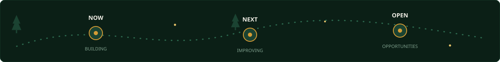
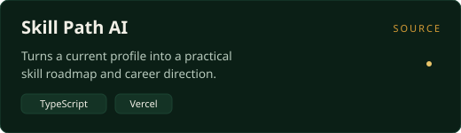
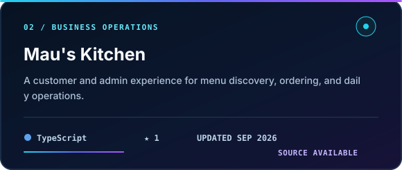
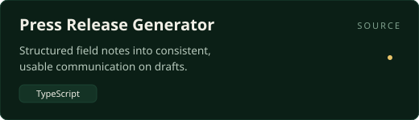
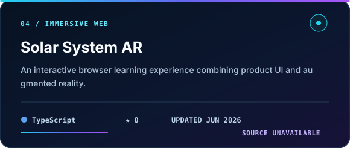
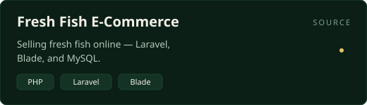
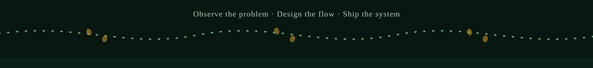

  

   

  

   

  <a href="https://sutan.dev"><strong>PORTFOLIO</strong></a>
  &nbsp;&nbsp;／&nbsp;&nbsp;
  <a href="https://github.com/Sutannn13?tab=repositories"><strong>PROJECTS</strong></a>
  &nbsp;&nbsp;／&nbsp;&nbsp;
  <a href="mailto:sutanarliejohan@gmail.com"><strong>EMAIL</strong></a>
  &nbsp;&nbsp;／&nbsp;&nbsp;
  <a href="https://www.linkedin.com/in/sutan-arlie-johan-38877635b"><strong>LINKEDIN</strong></a>

## `01 / TRAILHEAD`

I am **Sutan Arlie Johan**, an Information Technology student and backend-focused full-stack developer based in Depok, Indonesia.

I turn rough ideas, manual processes, and scattered data into systems that feel clear to the people using them. My work sits between **backend engineering, product thinking, automation, and interface execution** — from data model and API to deployment.

  

<table>
  <tr>
    <td width="33%" valign="top">
      <strong>NOW / BUILDING</strong>  
      Operational tools, REST APIs, and useful web products.
    </td>
    <td width="33%" valign="top">
      <strong>NEXT / IMPROVING</strong>  
      Testing, system design, realtime data, and deployment workflows.
    </td>
    <td width="34%" valign="top">
      <strong>OPEN / OPPORTUNITIES</strong>  
      Junior roles, internships, and focused product collaborations.
    </td>
  </tr>
</table>

## `02 / FIELD GUIDE — SELECTED PROJECTS`

<table>
  <tr>
    <td width="50%" valign="top">
      
       
      <a href="https://github.com/Sutannn13/Skill-Path-AI">Skill Path AI source ↗</a> · Demo currently unavailable
    </td>
    <td width="50%" valign="top">
      
       
      <a href="https://github.com/Sutannn13/mau-s-kitchen">Mau's Kitchen source ↗</a> · <a href="https://maukitchen.my.id">Live product ↗</a>
    </td>
  </tr>
  <tr>
    <td width="50%" valign="top">
      
       
      <a href="https://github.com/Sutannn13/press-release-auto-generate">Press Release Generator source ↗</a>
    </td>
    <td width="50%" valign="top">
      
       
      <a href="https://github.com/Sutannn13/ar-tata-surya">Solar System AR source ↗</a> · Demo currently unavailable
    </td>
  </tr>
  <tr>
    <td width="50%" valign="top">
      
       
      <a href="https://github.com/Sutannn13/E-commerce-platform-for-fresh-fish-transactions">Source ↗</a>
    </td>
    <td width="50%" valign="top">
      
       
      <a href="https://github.com/Sutannn13/HMTI-MARGONDA">Source ↗</a>
    </td>
  </tr>
</table>

  

## `03 / FOOTPRINTS`

  

The snake above is drawn from real contribution data and refreshes daily through GitHub Actions. No frozen counters — the trail speaks for itself.

## `04 / WORKING STACK`

| Layer | Tools and focus |
|---|---|
| **Backend systems** | `Laravel` `PHP` `REST API` `MySQL` `API testing` |
| **Product interface** | `TypeScript` `JavaScript` `HTML` `CSS` `Tailwind CSS` |
| **Workflow** | `Git` `GitHub Actions` `Postman` `Figma` `Deployment` |
| **Currently extending** | `Supabase` `Realtime systems` `Automated testing` `System design` |

  

  

## `05 / PROOF OF WORK`

- **2nd place — UBSI West Java IT Bootcamp**, building the Trash Point web application.
- Registered **HKI inventor** for Trash Point.
- Research contributor to the **SALI App** publication in JITK, accredited **SINTA 2**.
- Certified in **MikroTik MTCNA** and **Cisco Networking** fundamentals.

## `06 / CONTACT`

If you are building a practical web product, backend system, or operational tool, I would like to hear about the problem behind it.

  <a href="mailto:sutanarliejohan@gmail.com"><strong>START A CONVERSATION</strong></a>
  &nbsp;&nbsp;·&nbsp;&nbsp;
  <a href="https://www.linkedin.com/in/sutan-arlie-johan-38877635b"><strong>VIEW LINKEDIN</strong></a>

  

